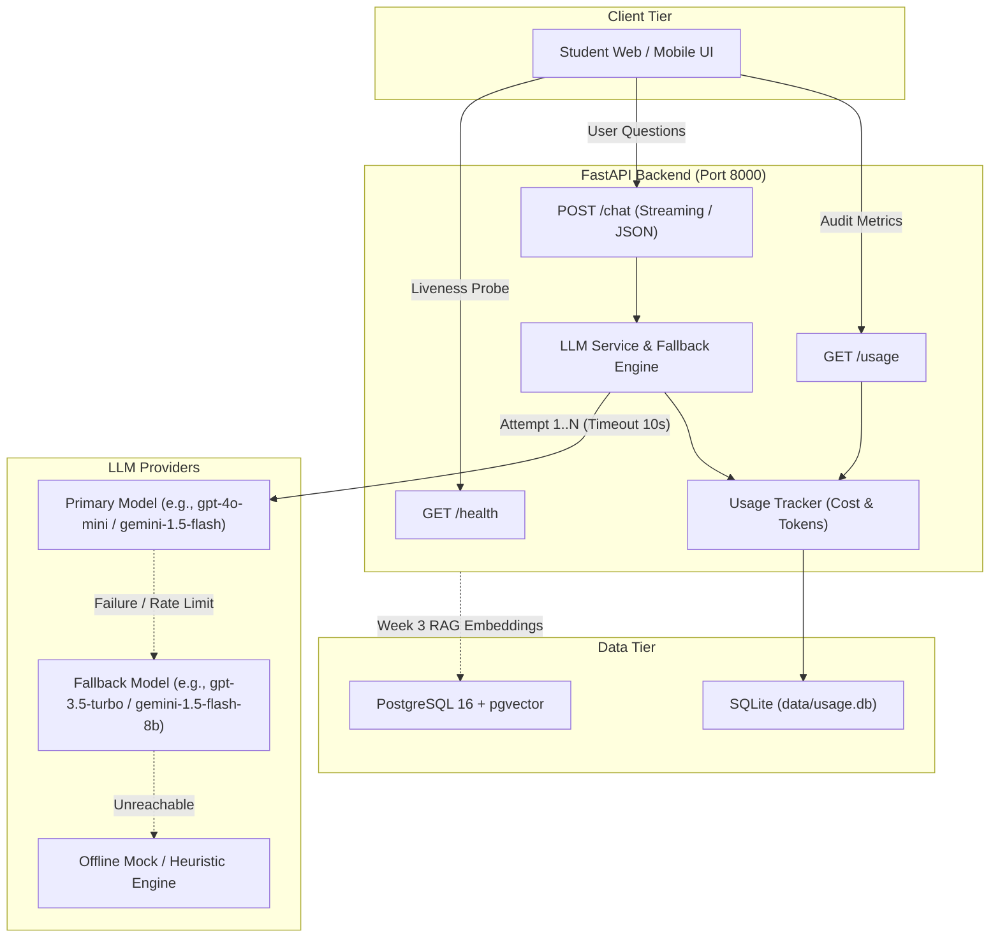
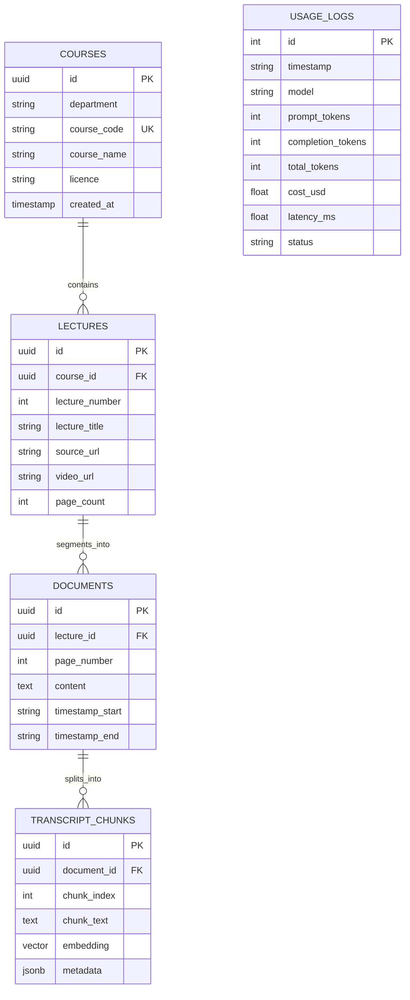
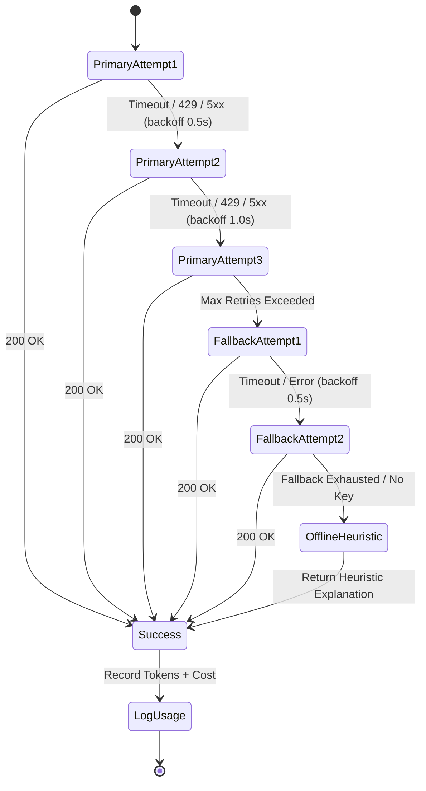

# LectureLoom System Design Document

> **Architecture, API Endpoints, and Database Schema**  
> Tamil Cross-Language Course Help Desk for Engineering Students

---

## 1. System Architecture Overview

LectureLoom enables Tamil Nadu engineering students to ask technical questions in Tamil, Tanglish (code-mixed), or English and receive accurate, cited explanations extracted from English NPTEL lecture transcripts.



---

## 2. API Endpoints Specification

### 2.1 Liveness Probe: `GET /health`
Verifies that the API service is running. Must respond immediately without calling the database or LLMs.

- **Method**: `GET`
- **Path**: `/health`
- **Response**: `200 OK`
- **Content-Type**: `application/json`
- **Response Schema**:
  ```json
  {
    "status": "ok",
    "app": "examate-rag",
    "environment": "local"
  }
  ```

---

### 2.2 LLM Chat: `POST /chat`
Submits a user prompt or question to the LLM backend. Supports structured JSON responses or Server-Sent Events (SSE) streaming with multi-tier model fallback.

- **Method**: `POST`
- **Path**: `/chat`
- **Headers**: `Content-Type: application/json`
- **Request Body**:
  ```json
  {
    "message": "டிரான்சிஸ்டர் எப்படி ஸ்விட்சாக வேலை செய்கிறது?",
    "history": [
      {
        "role": "user",
        "content": "Digital Electronics basic concepts"
      },
      {
        "role": "assistant",
        "content": "Sure, which topic would you like to explore?"
      }
    ],
    "stream": false,
    "temperature": 0.7,
    "max_tokens": 800,
    "department": "ECE"
  }
  ```

- **Query / Body Parameters**:
  | Field | Type | Required | Default | Description |
  |---|---|---|---|---|
  | `message` | string | Yes | — | The student's question in Tamil, Tanglish, or English. |
  | `history` | array | No | `[]` | Conversation history objects `{"role": str, "content": str}`. |
  | `stream` | boolean | No | `false` | If `true`, streams Server-Sent Events (`text/event-stream`). |
  | `temperature` | float | No | `0.7` | Sampling randomness between 0.0 and 2.0. |
  | `max_tokens` | integer | No | `800` | Max completion tokens to generate (1–4096). |
  | `department` | string | No | `null` | Engineering discipline filter (e.g., `CSE`, `ECE`). |

- **Response (Structured JSON, `stream: false`)**:
  - **Status**: `200 OK`
  - **Content-Type**: `application/json`
  - **Payload**:
    ```json
    {
      "response": "டிரான்சிஸ்டர் (Transistor) ஒரு எலக்ட்ரானிக் ஸ்விட்சாக Cut-off மற்றும் Saturation நிலைகளில் இயங்குகிறது...",
      "model_used": "gpt-4o-mini",
      "tokens_in": 78,
      "tokens_out": 142,
      "cost_usd": 0.0000969,
      "latency_ms": 612.4,
      "citations": []
    }
    ```

- **Response (Streaming, `stream: true`)**:
  - **Status**: `200 OK`
  - **Content-Type**: `text/event-stream`
  - **Event Format**:
    ```text
    data: {"chunk": "டிரான்சிஸ்டர் ", "model": "gpt-4o-mini", "done": false}

    data: {"chunk": "ஒரு எலக்ட்ரானிக் ", "model": "gpt-4o-mini", "done": false}

    data: {"done": true, "model_used": "gpt-4o-mini", "tokens_in": 78, "tokens_out": 142, "cost_usd": 0.0000969, "latency_ms": 612.4}
    ```

---

### 2.3 Token Consumption & Cost: `GET /usage`
Returns aggregated token usage, cumulative costs, and individual model breakdowns.

- **Method**: `GET`
- **Path**: `/usage`
- **Response**: `200 OK`
- **Content-Type**: `application/json`
- **Response Schema**:
  ```json
  {
    "total_requests": 24,
    "total_prompt_tokens": 1820,
    "total_completion_tokens": 3410,
    "total_tokens": 5230,
    "total_cost_usd": 0.002319,
    "by_model": {
      "gpt-4o-mini": {
        "calls": 20,
        "prompt_tokens": 1520,
        "completion_tokens": 2890,
        "total_tokens": 4410,
        "total_cost_usd": 0.001962
      },
      "gpt-3.5-turbo": {
        "calls": 4,
        "prompt_tokens": 300,
        "completion_tokens": 520,
        "total_tokens": 820,
        "total_cost_usd": 0.000357
      }
    },
    "recent_calls": [
      {
        "id": 24,
        "timestamp": "2026-10-30T10:15:30.123456+00:00",
        "model": "gpt-4o-mini",
        "prompt_tokens": 78,
        "completion_tokens": 142,
        "total_tokens": 220,
        "cost_usd": 0.000097,
        "latency_ms": 612.4,
        "status": "success"
      }
    ]
  }
  ```

---

### 2.4 Planned Endpoints (Week 3 Roadmap)

| Endpoint | Method | Purpose |
|---|---|---|
| `/ask` | `POST` | Answers queries with explicit `[document, page, timestamp]` citations. |
| `/documents` | `GET` | Lists indexed course transcripts with filter by department and code. |
| `/embed` | `POST` | Ingestion endpoint to chunk and embed lecture transcripts into pgvector. |

---

## 3. Database Schemas and Tables

The storage architecture consists of two data stores:
1. **SQLite Database** (`data/usage.db`): Lightweight, zero-dependency storage for call audit logs, token counts, and API costs.
2. **PostgreSQL 16 with `pgvector`** (Port `5432`): High-performance relational and vector storage for course transcripts, metadata, and chunk embeddings.



### 3.1 Relational & Vector Tables (PostgreSQL / pgvector)

#### Table: `courses`
Stores academic department and syllabus metadata.
```sql
CREATE TABLE courses (
    id UUID PRIMARY KEY DEFAULT gen_random_uuid(),
    department VARCHAR(16) NOT NULL,            -- e.g., 'CSE', 'ECE', 'EEE'
    course_code VARCHAR(32) NOT NULL UNIQUE,     -- e.g., 'CS8492'
    course_name VARCHAR(255) NOT NULL,          -- e.g., 'Database Management Systems'
    licence VARCHAR(64) DEFAULT 'CC BY-NC-SA 4.0',
    created_at TIMESTAMP WITH TIME ZONE DEFAULT CURRENT_TIMESTAMP
);
```

#### Table: `lectures`
Stores lecture indices, titles, and NPTEL links.
```sql
CREATE TABLE lectures (
    id UUID PRIMARY KEY DEFAULT gen_random_uuid(),
    course_id UUID NOT NULL REFERENCES courses(id) ON DELETE CASCADE,
    lecture_number INT NOT NULL,
    lecture_title VARCHAR(255) NOT NULL,
    source_url TEXT NOT NULL,
    video_url TEXT,
    page_count INT NOT NULL DEFAULT 0,
    created_at TIMESTAMP WITH TIME ZONE DEFAULT CURRENT_TIMESTAMP,
    CONSTRAINT uq_course_lecture UNIQUE (course_id, lecture_number)
);
```

#### Table: `documents` (Pages)
Stores discrete transcript pages with temporal boundaries.
```sql
CREATE TABLE documents (
    id UUID PRIMARY KEY DEFAULT gen_random_uuid(),
    lecture_id UUID NOT NULL REFERENCES lectures(id) ON DELETE CASCADE,
    page_number INT NOT NULL,
    content TEXT NOT NULL,
    timestamp_start VARCHAR(32),                -- e.g., '17:46'
    timestamp_end VARCHAR(32),                  -- e.g., '24:00'
    created_at TIMESTAMP WITH TIME ZONE DEFAULT CURRENT_TIMESTAMP,
    CONSTRAINT uq_lecture_page UNIQUE (lecture_id, page_number)
);
```

#### Table: `transcript_chunks` (pgvector)
Stores vectorized segments for cross-language semantic retrieval.
```sql
CREATE EXTENSION IF NOT EXISTS vector;

CREATE TABLE transcript_chunks (
    id UUID PRIMARY KEY DEFAULT gen_random_uuid(),
    document_id UUID NOT NULL REFERENCES documents(id) ON DELETE CASCADE,
    chunk_index INT NOT NULL,
    chunk_text TEXT NOT NULL,
    embedding VECTOR(1536),                     -- 1536-dim (OpenAI/text-embedding-3-small) or 768-dim (multilingual-e5)
    metadata JSONB DEFAULT '{}'::jsonb,
    created_at TIMESTAMP WITH TIME ZONE DEFAULT CURRENT_TIMESTAMP
);

-- HNSW Cosine Index for sub-millisecond approximate nearest neighbor search
CREATE INDEX idx_chunks_embedding_hnsw 
ON transcript_chunks 
USING hnsw (embedding vector_cosine_ops)
WITH (m = 16, ef_construction = 64);
```

---

### 3.2 Audit Log Table (SQLite / `usage_logs`)
Stores token counts and USD costs for all calls.

```sql
CREATE TABLE IF NOT EXISTS usage_logs (
    id INTEGER PRIMARY KEY AUTOINCREMENT,
    timestamp TEXT NOT NULL,
    model TEXT NOT NULL,
    prompt_tokens INTEGER NOT NULL,
    completion_tokens INTEGER NOT NULL,
    total_tokens INTEGER NOT NULL,
    cost_usd REAL NOT NULL,
    latency_ms REAL NOT NULL,
    status TEXT NOT NULL
);

CREATE INDEX IF NOT EXISTS idx_usage_model ON usage_logs(model);
CREATE INDEX IF NOT EXISTS idx_usage_timestamp ON usage_logs(timestamp);
```

---

## 4. Model Fallback and Retry Policy

When a user sends a query, the backend attempts to call the **Primary Model**. If network instability, rate limits, or timeouts occur, it applies exponential backoff before shifting to the **Fallback Model**.



### Fallback Policy Rules:
1. **Per-Call Timeout**: Default 10.0 seconds (`LLM_TIMEOUT_SECONDS`).
2. **Retries**: Up to 2 retries (`LLM_MAX_RETRIES`) per tier.
3. **Backoff Schedule**: $t = 0.5 \times 2^{\text{attempt}}$ seconds.
4. **Offline Resilience**: If no remote provider is reachable or no API key is provisioned, the local heuristic engine generates an accurate Tamil/English explanation so that CI builds, test suites, and offline environments remain $100\%$ green.

---

## 5. Token Pricing Matrix (USD per 1M Tokens)

| Model | Prompt / Input Cost ($/1M) | Completion / Output Cost ($/1M) | Typical Use Case |
|---|---:|---:|---|
| `gpt-4o-mini` | $0.15 | $0.60 | Primary production chat & reasoning |
| `gemini-1.5-flash` | $0.075 | $0.30 | High-speed multilingual primary |
| `gemini-1.5-flash-8b` | $0.0375 | $0.15 | Ultra-low cost fallback |
| `gpt-3.5-turbo` | $0.50 | $1.50 | Legacy fallback model |
| `gpt-4o` | $2.50 | $10.00 | Complex cross-language evaluation |
| `gemini-1.5-pro` | $1.25 | $5.00 | Deep technical verification |
| `claude-3-haiku` | $0.25 | $1.25 | Fast alternative fallback |

**Cost Formula**:
$$\text{Cost} = \frac{(\text{Prompt Tokens} \times \text{Rate}_{\text{prompt}}) + (\text{Completion Tokens} \times \text{Rate}_{\text{comp}})}{1,000,000}$$
